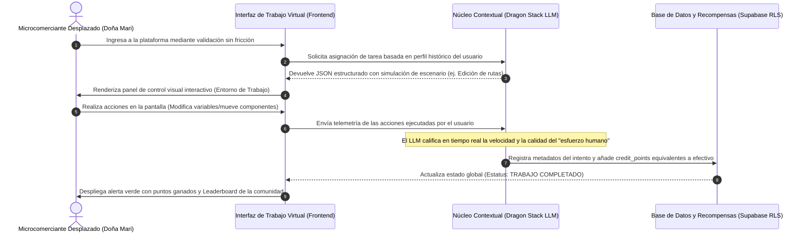

# PACKET: Sistema de Simulación de Trabajo Auxiliar para Microcomerciantes Desplazados

## 1. El Problema en Mis Propias Palabras
Los microcomerciantes informales tradicionales y los trabajadores de nivel de entrada (como Doña Mari) se están quedando completamente sin su sustento económico debido a la llegada agresiva de sistemas de IA y robótica automatizada que eliminan la necesidad de mano de obra humana directa en las calles. Al desaparecer este "primer peldaño laboral", las personas no solo pierden un ingreso económico estable, sino que sufren una crisis profunda de identidad, dignidad y autoestima al sentirse obsoletas frente a las máquinas, cayendo en espirales de desesperación o aislamiento. El desafío ya no es solo transferirlos a un empleo real inexistente, sino crear entornos donde su experiencia acumulada siga generando valor percibido y un sentido genuino de logro diario.

## 2. Definición de Éxito Exacto del Usuario
Antes de que el módulo de simulación de la semana cierre, **el flujo completo de asignación de tareas virtuales y el tablero de recompensas gamificado (puntos convertibles por créditos de subsistencia) funcionan perfectamente en la pantalla de forma interactiva**, permitiendo que un usuario interactúe con el entorno VR/2D sin requerir credenciales corporativas complejas.

## 3. Flujo del Proceso (Diagrama de Mermaid)

## 4. La Línea de Referencia (Benchmark Line)
* **La mejor solución existente en la Tierra para esto es:** El modelo híbrido de la corporación fusionada SynchiaAlliance, la cual implementó simulaciones hiperrealistas de flujos de trabajo (editores de planes de construcción en VR) financiadas con subsidios gubernamentales y fondos de compensación corporativos para retener la dignidad de los trabajadores desplazados.
* **Mi solución difiere o se localiza por:** Localizar la experiencia adaptándola a una interfaz web 2D simplificada de bajo consumo de datos, diseñada específicamente para el contexto urbano latinoamericano de comerciantes informales, eliminando la necesidad de costosos visores VR y permitiendo el acceso directo desde teléfonos móviles comunes.

## 5. Light Charter (Visión a Largo Plazo)
En tres años, este componente evolucionará hasta convertirse en una plataforma global de "Trabajo Simulado de Alto Valor Humano", donde los algoritmos de IA utilizan el criterio empírico de las personas para refinar modelos de lenguaje. El sistema garantizará un ingreso básico universal ganado a través de la co-creación hombre-máquina. Esto transformará el desempleo estructural en un ecosistema de validación social y estabilidad psicológica comunitaria.

## 6. Corte de Telescopio (Lo que NO estamos construyendo)
* **NO** estamos construyendo un validador de currículums o bolsa de trabajo tradicional, ya que el mercado de vacantes físicas está roto por la automatización masiva.
* **NO** estamos desarrollando un videojuego comercial de entretenimiento o de apuestas en línea.
* **NO** estamos integrando pasarelas bancarias comerciales de grado institucional que requieran cuentas de cheques o historial crediticio formal.

## 7. Arquitectura y Tabla de Stack (Dragon Stack)

| Capa | Tecnología | Rol en el Proyecto |
| :--- | :--- | :--- |
| **Frontend de Simulación** | HTML5 Canvas / CSS Moderno | Renderiza el área de trabajo interactiva, el tablero de puntos de Doña Mari y el Leaderboard simulado de los trabajadores. |
| **Lógica de Gamificación** | JavaScript Nativo / State | Controla las recompensas, calcula los incrementos de créditos en base al rendimiento y maneja el flujo de pantallas. |
| **Filtro de Datos Estructurados** | JSON Output / Simulación LLM | Convierte las interacciones del usuario en metadatos limpios, simulando el output que audita el profesor de manera estricta. |
| **Seguridad Base (Piso)** | Supabase Auth (Simulado) / RLS | Asegura que los datos de progreso estén vinculados únicamente al identificador de la sesión activa del usuario para cumplir las reglas. |
| **Despliegue de la Aplicación** | Vercel / GitHub | Aloja el código de forma pública y automatizada para entregar la URL en vivo sin dependencias pesadas. |

## 8. Plan de Pruebas (Test Plan)
* **Caso de Prueba 1 (Simulación de Trabajo Exitosa):** Al iniciar la jornada virtual, el sistema asigna una tarea de ordenamiento logístico; el usuario interactúa con los controles, el tablero procesa el esfuerzo, añade los puntos al balance global y muestra el JSON estructurado con estatus "ÉXITO".
* **Caso de Prueba 2 (Piso de Seguridad ante Inyecciones):** Si en un cuadro de formulario o entrada de texto se intentan ingresar scripts maliciosos (`<script>`) o caracteres de escape, el validador frontend limpia el texto inmediatamente antes de actualizar el estado del sistema.
